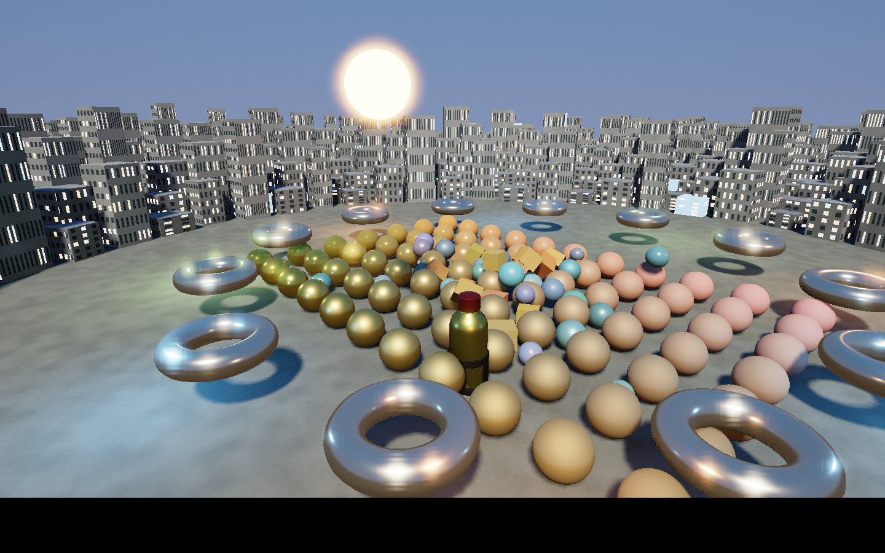

# Photon3D



Rust製のリアルタイム物理ベース3Dエンジンです。`wgpu` / WGSL を使い、GPUインスタンシング・データ指向シーン更新・HDRポストプロセスを備えた拡張可能な基盤として実装しています。

現在のサンドボックスは約1,300個以上のオブジェクトをメッシュ種別ごとのインスタンスバッチに整理し、PBRマテリアルグリッド、金属トーラス、プロシージャルな都市ジオメトリ、CC0のglTF WaterBottle実アセット、動的ポイントライトに加え、重力・衝突・摩擦・反発で落下/散乱する44個の動的剛体を描画します。

## 実行

```bash
cargo run --release
```

GPUドライバーとVulkan/Metal/DX12対応環境で実行してください。ソフトウェアRasterizer（llvmpipe）でも動作しますが、GPUを使わないため速度は出ません。

## ベンチマーク

ウィンドウタイトルにはfps、表示/カリング済みインスタンス数、scene/shadow draw call、三角形数、CPU submit/scene時間、physics時間、GPUパス時間を表示します。GPU時間は`TIMESTAMP_QUERY`対応デバイスでshadow/scene/SSAO/bloom/compositeパスから取得します。

固定フレーム数のJSONベンチマークも実行できます。

```bash
PHOTON3D_BENCHMARK_FRAMES=120 cargo run --release
```

出力例:

```json
{"benchmark":{"frames":5,"gpu_frames":5,"cpu_submit_ms_avg":183.7560,"cpu_scene_ms_avg":1.9402,"cpu_physics_ms_avg":1.7788,"gpu_ms_avg":176.9758,"visible_instances":615,"culled_instances":771,"scene_draw_calls":5,"shadow_draw_calls":5,"triangles":562352}}
```

この数値はVM上のllvmpipe（CPUラスタライザ）のものであり、実GPU性能ではありません。最適化前後の比較には同一環境で実行してください。`gpu_frames`が`frames`より少ない場合、非同期readbackが間に合わなかったフレームがあり、GPU平均は取得できたサンプルだけで計算されています。

## 操作

- 左クリック: マウスキャプチャ
- マウス: 視点回転
- `W/A/S/D`: 移動
- `E` / `Space`: 上昇
- `Q` / `Ctrl`: 下降
- `Shift`: 高速移動
- `R`: カメラリセット
- `Esc`: マウス解放

## 実装済みの主要技術

### レンダリング

- Cook-Torrance microfacet BRDF
  - GGX normal distribution
  - Smith/Schlick-GGX geometry attenuation
  - Schlick Fresnel
  - metallic / roughnessワークフロー
- HDR linear lighting（`Rgba16Float`）
- directional lightの2048² shadow map + blocker search付きPCSS風contact-hardening shadow（16-tap Poisson PCF）
- 8つの動的ポイントライト（逆二乗減衰 + 半径フォールオフ）
- 視空間法線・視深バッファを使った安定化スクリーンスペースAO（ambient lightingのみへ適用）
- threshold + soft kneeによる高輝度抽出、分離Gaussian bloom
- 手続き sky gradient / sun diskとroughness応答つき環境specular照明
- Narkowicz近似のACES filmic tone mapping
- プロシージャル建築コンクリート / 窓 / 地表ミネラル detail
- glTF 2.0 mesh/node transform loading
- base color / normal / metallic-roughness / emissive / occlusion texture sampling
- sRGB base color/emissive texture、linear metallic-roughness/normal/occlusion texture
- tangent-space normal mapping（missing tangent時はUVから生成）
- vignetteと少量のfilm grain

### 物理シミュレーション

- `rapier3d`による3D剛体シミュレーション
- 地球重力、固定60Hzタイムステップ、最大5サブステップの蓄積式時間統合
- 球・直方体・三角形メッシュコライダー（動的剛体と静的環境）
- density由来の質量/慣性、摩擦、反発係数、線形/角減衰
- 高速剛体のcontinuous collision detection、sleeping、BVH broadphase
- 物理姿勢を描画transformへ毎フレーム同期
- 物理更新時間をウィンドウタイトルとJSONベンチマークへ計測出力

### 高速化設計

- Rust + `wgpu`による安全なGPU API利用
- mesh kindごとのinstanced batching
- 1フレーム1本の contiguous instance streamへ変換し、GPU側インスタンス属性として供給
- camera frustum sphere culling
- `rayon`によるデータ並列シーン更新と`rapier3d` parallel solver
- release profileでthin LTO / single codegen unit
- 動的メッシュ再生成を避け、プロシージャルメッシュはGPUリソースとして保持
- glTF texture/mesh/material bind group cache
- GPU timestamp queryによるパス別計測

## 参考にした論文・資料

実装方針は次の研究を参照しています。直接の移植ではなく、リアルタイム用途に合わせた近似です。

1. **Cook & Torrance, “A Reflectance Model for Computer Graphics” (1982)**  
   microfacet BRDF、Fresnel、幾何減衰、法線分布による反射モデルの基礎。  
   <https://doi.org/10.1145/357290.357293>

2. **Walter, Marschner, Li, Torrance, “Microfacet Models for Refraction through Rough Surfaces” (EGSR 2007)**  
   GGX分布とshadowing/maskingの理論。GGX NDF選択の根拠。  
   <https://www.cs.cornell.edu/~srm/publications/EGSR07-btdf.pdf>

3. **Olsson, Billeter, Assarsson, “Clustered Deferred and Forward Shading” (2012)**  
   多数ライトを扱うclustered shadingの設計資料。現在は8灯の直接ループだが、light assignmentをGPUクラスタへ移行する拡張点とする。  
   <https://www.cse.chalmers.se/~uffe/clustered_shading_preprint.pdf>

4. **Bavoil & Sainz / NVIDIA, “Screen Space Ambient Occlusion” / HBAO系資料**  
   深度・法線バッファから近傍遮蔽を推定する方針。Photon3Dでは視空間深バッファを明示的に出力し、GLバックエンドでも動く実装にしている。  
   <https://artis.inrialpes.fr/Membres/Olivier.Hoel/ssao/nVidiaHSAO/ScreenSpaceAO.pdf>

5. **Reeves, Salesin, Cook, “Rendering Antialiased Shadows with Depth Maps” (1987) / Fernando, “Percentage-Closer Soft Shadows” (2005)**  
   shadow mapとPCF filtering、受光面・遮蔽物距離に応じたpenumbra近似の根拠。現在は単一cascadeのPCSS風近似。\
   <https://developer.download.nvidia.com/shaderlibrary/docs/shadow_PCSS.pdf>

6. **Narkowicz, “ACES Filmic Tone Mapping Curve” (2016)**  
   RRT/ODTを近似した低コストACES fit。HDRからSDRへの表示変換に使用。  
   <https://knarkowicz.wordpress.com/2016/01/06/aces-filmic-tone-mapping-curve/>

7. **Karis, “Nanite: A Deep Dive” (SIGGRAPH 2021)**  
   GPU-driven rendering、単一大容量ジオメトリバッファ、GPU cullingの方向性。現段階ではCPU frustum culling + instancingだが、最終的にはGPU-driven cullingへ移行する設計。  
   <https://www.realtimerendering.com/advances/s2021/Karis_Nanite_SIGGRAPH_Advances_2021_final.pdf>

8. **Rapier physics engine documentation / Dimforge**
   impulse solver、BVH broadphase、CCD、sleeping、材質係数を備えたリアルタイム剛体シミュレーション基盤。Photon3DではRapierを利用しつつ、固定タイムステップとシーン同期をエンジン側で実装している。
   <https://rapier.rs/docs/>

## アーキテクチャ

```text
photon3d library
├─ camera.rs      camera math, view/projection, frustum planes
├─ assets.rs      glTF import, image conversion, normals/tangents, material metadata
├─ mesh.rs        procedural indexed meshes, normals/tangents, validation tests
├─ physics.rs     Rapier rigid bodies, colliders, fixed timestep, CCD, respawn
├─ scene.rs       data-oriented objects, materials, lights, animation, culling input
└─ renderer/
   ├─ mod.rs      wgpu device/surface, render passes, batching, resources
   └─ uniforms.rs CPU-side uniform layouts
```

描画パス:

```text
scene update (parallel) + fixed-timestep rigid-body physics
  → frustum culling + mesh-kind instanced batching
  → directional shadow depth pass
  → PBR scene pass (HDR color + view normal + view depth MRT)
  → SSAO pass
  → bloom bright pass
  → horizontal/vertical Gaussian blur
  → sky + AO + bloom + ACES composite
```

## 現在の制限と次の拡張

これは完全な商用エンジンではなく、拡張可能な第一版です。次の重要項目は明確に分離して実装できます。

- glTF alpha blending/masking、skinning、morph targets、texture transform
- clustered forward+ light assignment
- GPU compute frustum/occlusion culling と indirect draw
- cascaded shadow maps / moment shadow maps
- TAA / temporal reprojection、AO denoise
- prefiltered environment map / BRDF LUTによる本格的IBL
- ECS、asset hot reload、joints/constraints、character controller
- bindless texture array

## 検証

```bash
cargo test
cargo clippy --all-targets -- -D warnings
cargo build --release
PHOTON3D_BENCHMARK_FRAMES=120 cargo run --release
```
